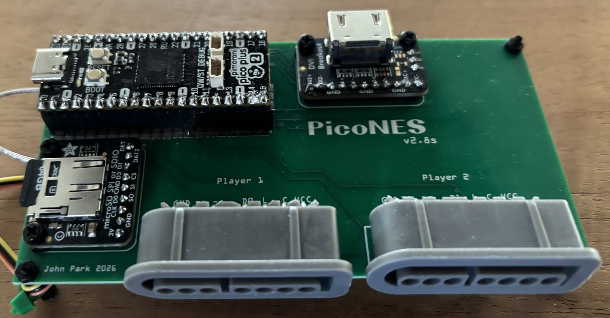
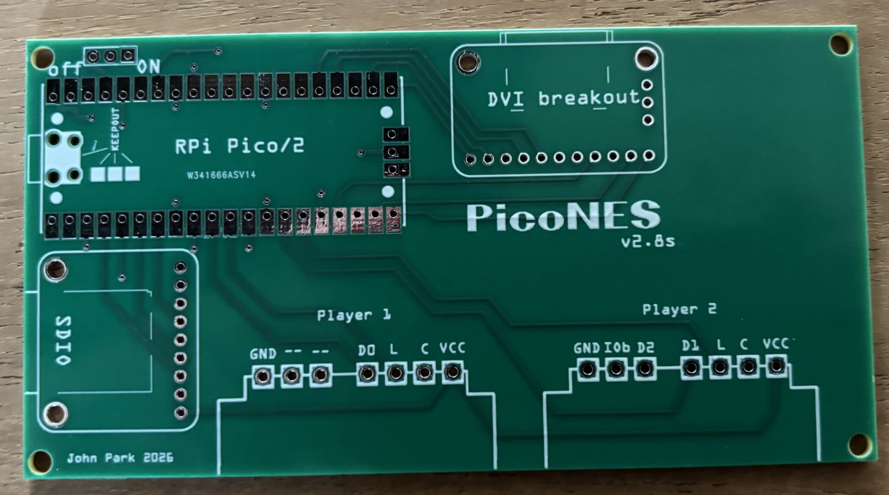
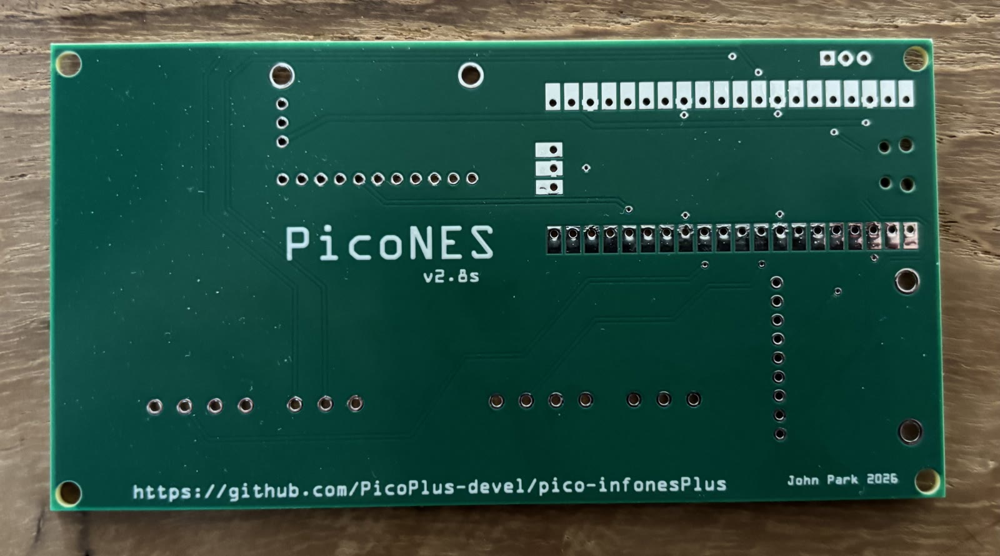
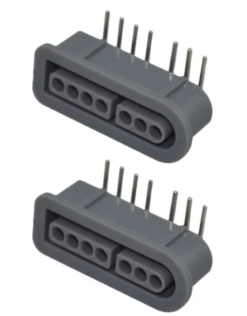
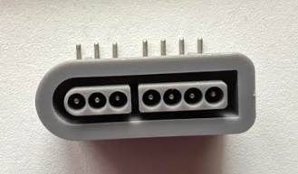

# PCB designs

This folder contains the Gerber files for the printed circuit boards (PCBs) that can be used with the Raspberry Pi Pico emulators of this project family, such as [pico-infonesPlus](https://github.com/fhoedemakers/pico-infonesPlus) (NES). Each zip file can be uploaded unchanged to a PCB manufacturer such as [PCBWay](https://www.pcbway.com/) or [JLCPCB](https://jlcpcb.com/).

All boards require soldering.

> [!NOTE]
> Sellers on AliExpress have copied these designs and sell pre-assembled boards. For questions about those boards, please contact the seller.

## Contents

- [Overview](#overview)
- [Ordering a PCB](#ordering-a-pcb)
- [PicoNES v2.6 (NES controller ports)](#picones-v26-nes-controller-ports)
- [PicoNES v2.8 (SNES controller ports)](#picones-v28-snes-controller-ports)
- [Pin assignment of the v2.x boards](#pin-assignment-of-the-v2x-boards)
- [PicoNES Mini (Waveshare RP2040-Zero / RP2350-Zero)](#picones-mini-waveshare-rp2040-zero--rp2350-zero)
- [PicoNES Micro (Waveshare RP2350-USB-A)](#picones-micro-waveshare-rp2350-usb-a)
- [Older designs](#older-designs)

## Overview

| Board | Gerber file | Microcontroller board | Controller ports | Designer | Build instructions |
| ----- | ----------- | --------------------- | ---------------- | -------- | ------------------ |
| PicoNES v2.6 | [pico_nesPCB_v2.6.zip](pico_nesPCB_v2.6.zip) | Raspberry Pi Pico, Pico 2 or Pimoroni Pico Plus 2 | 2 × NES | John Park | [This page](#picones-v26-nes-controller-ports) |
| PicoNES v2.8 SNES | [pico_nesPCB_v2.8_SNES_PORTS.zip](pico_nesPCB_v2.8_SNES_PORTS.zip) | Raspberry Pi Pico, Pico 2 or Pimoroni Pico Plus 2 | 2 × SNES | John Park | [This page](#picones-v28-snes-controller-ports) |
| PicoNES Mini v2.0 | [Gerber_PicoNES_Mini_PCB_v2.0.zip](Gerber_PicoNES_Mini_PCB_v2.0.zip) | Waveshare RP2040-Zero or RP2350-Zero | 2 × NES | Gavin Knight | [Instructables, step 1](https://www.instructables.com/PicoNES-RaspberryPi-Pico-Based-NES-Emulator/#step1) |
| PicoNES Micro v1.2 | [Gerber_PicoNES_Micro_v1.2.zip](Gerber_PicoNES_Micro_v1.2.zip) | Waveshare RP2350-USB-A | None, USB controller only | Gavin Knight | [Instructables, step 2](https://www.instructables.com/PicoNES-RaspberryPi-Pico-Based-NES-Emulator/#step2) |

Versions v2.1, v2.0 and v0.2 are older designs, see [Older designs](#older-designs).

Choosing a board:

- **v2.6** or **v2.8**: the easiest boards to build. The two are identical except for the controller ports: choose v2.6 for original NES controllers and v2.8 for original SNES controllers. Both also work with a USB controller.
- **Mini**: smaller and cheaper, but harder to solder. Recommended only for experienced builders.
- **Micro**: the smallest build, for USB controllers only. Requires micro-soldering skills.

## Ordering a PCB

1. Download the zip file of the board from the table above.
2. Upload the zip file, without extracting it, on the website of the PCB manufacturer.
3. The default options (2 layers, 1.6 mm thickness) are sufficient. The colour of the board can be chosen freely.

Manufacturers usually have a minimum order quantity of five boards.

## PicoNES v2.6 (NES controller ports)

A board for a Raspberry Pi Pico, Pico 2 or Pimoroni Pico Plus 2 with two NES controller ports, for one or two players. Designed by John Park ([@johnedgarpark](https://twitter.com/johnedgarpark)).

The board has through-holes for the microcontroller board. It can be mounted in two ways:

- **Soldered flat** onto the PCB, using a Pico or Pico 2 without headers.
- **On male pin headers** soldered into the through-holes. This works with a Pico, Pico 2 or Pimoroni Pico Plus 2.

Optionally, female socket headers can be soldered into the through-holes. The microcontroller board, fitted with male headers, then plugs into them and can be removed or swapped without desoldering.

Assembled board with two NES controllers (an earlier version is shown; v2.6 is assembled the same way):

### Bill of materials

**Microcontroller board** (choose one):

| | Part | Mounting |
| - | ---- | -------- |
|  | [Raspberry Pi Pico 2](https://www.adafruit.com/product/6006) or [Raspberry Pi Pico](https://www.adafruit.com/product/4864), without headers | Soldered flat onto the PCB |
|  | [Raspberry Pi Pico 2 with Header](https://www.adafruit.com/product/6328) or [Raspberry Pi Pico H](https://www.adafruit.com/product/5525) | Headers soldered into the through-holes |
|  | Pimoroni Pico Plus 2 ([Adafruit](https://www.adafruit.com/product/6244), [Pimoroni](https://shop.pimoroni.com/products/pimoroni-pico-plus-2?variant=42092668289107)) | Headers soldered into the through-holes. Cannot be soldered flat, because the SP/CE connector on its back is in the way. |

The wireless versions (Pico W, Pico 2 W) can be used as well.

**Other parts**:

| | Qty | Part | Notes |
| - | --- | ---- | ----- |
|  | 1 | [Adafruit DVI Breakout Board - For HDMI Source Devices](https://www.adafruit.com/product/4984) | Header included |
|  | 1 | [Adafruit Micro SD SPI or SDIO Card Breakout Board - 3V ONLY!](https://www.adafruit.com/product/4682) | Header included |
|  | 1 or 2 | [NES controller port, 7-pin, 90 degrees](https://www.zedlabz.com/products/controller-connector-port-for-nintendo-nes-console-7-pin-90-degree-replacement-2-pack-black-zedlabz) | One port per player |
|  | 1 | [Breadboard-friendly SPDT Slide Switch](https://www.adafruit.com/product/805) | Optional on/off switch, 2.54 mm pin spacing |
|  | 2 × 20 pins | [Break-away 0.1" male header](https://www.adafruit.com/product/392) | Only needed to mount a Pico without headers on pin headers |
|  | 2 × 20 pins | [Socket Headers for Raspberry Pi Pico - 2 x 20 pin Female Headers](https://www.adafruit.com/product/5583) | Optional female headers, soldered into the PCB. A microcontroller board with male headers plugs into them, which makes swapping boards easy. |

**Also needed**:

- A microSD card and an HDMI cable.
- A USB power supply: micro-USB for a Pico or Pico 2, USB-C for a Pimoroni Pico Plus 2.
- One or two original NES controllers.
- Optional: a USB controller. On a Pico or Pico 2, this requires a [micro-USB OTG Y-cable](https://a.co/d/b9t11rl) to connect both the power supply and the controller.

Product pictures: [Adafruit Industries](https://www.adafruit.com), except the NES controller port picture, which is from [ZedLabz](https://www.zedlabz.com).

### Assembly notes

- Solder every pin of the microcontroller board, including the pads on its short edge (one of these is ground).
- A Pimoroni Pico Plus 2 must be mounted on pin headers.
- When the microcontroller board is mounted on pin headers, it sits higher on the PCB. Use the latest top cover of the [3D-printed case](#3d-printed-case); older covers do not leave enough room for the USB cable.

### Firmware

The board uses hardware configuration 2 (`HW_CONFIG 2`). Download the `AdafruitDVISD` binary that matches the microcontroller board from the releases page of the emulator:

| Microcontroller board | Firmware file |
| --------------------- | ------------- |
| Raspberry Pi Pico | `<emulator>_AdafruitDVISD_pico_arm.uf2` |
| Raspberry Pi Pico W | `<emulator>_AdafruitDVISD_pico_w_arm.uf2` |
| Raspberry Pi Pico 2 or Pimoroni Pico Plus 2 | `<emulator>_AdafruitDVISD_pico2_arm.uf2` |
| Raspberry Pi Pico 2 W | `<emulator>_AdafruitDVISD_pico2_w_arm.uf2` |

For example, `piconesPlus_AdafruitDVISD_pico2_arm.uf2` for the NES emulator on a Pico 2. Some emulators are released for the Pico 2 only. On a Pimoroni Pico Plus 2, the emulators use the on-board PSRAM.

### NES Zapper

On v2.6 (and v2.1), pins D3 and D4 of controller port 2 are connected to GPIO27 and GPIO28. This allows a light gun to be used with the NES emulator. See the [NES Zapper section of pico-infonesPlus](https://github.com/fhoedemakers/pico-infonesPlus#nes-zapper-light-gun) for the requirements.

### 3D-printed case

Gavin Knight ([DynaMight1124](https://github.com/DynaMight1124)) designed an NES-style case for this board: [Thingiverse 6689537](https://www.thingiverse.com/thing:6689537). Two top covers are available, one with a button that presses the BOOTSEL button for firmware updates and one without. Make sure to print the files that match your PCB version. For questions about the case, please contact the designer on the Thingiverse page.

| Top cover without button | Top cover with BOOTSEL button |
| ------------------------ | ----------------------------- |
|  |  |
| **Base** | **On/off switch** |
|  |  |

## PicoNES v2.8 (SNES controller ports)

The same board as v2.6, with two SNES controller ports instead of NES controller ports. Designed by John Park ([@johnedgarpark](https://twitter.com/johnedgarpark)).

Everything described for [v2.6](#picones-v26-nes-controller-ports) applies to this board as well: the mounting options, the assembly notes and the firmware. The firmware detects the SNES controllers automatically.

Assembled with a Pimoroni Pico Plus 2 on pin headers:

| Front | Back |
| ----- | ---- |
|  |  |

### Bill of materials

The same as [v2.6](#bill-of-materials), with these differences:

| | Qty | Part | Notes |
| - | --- | ---- | ----- |
|  | 1 or 2 | [SNES controller port, 7-pin, 90 degrees](https://www.zedlabz.com/products/zedlabz-7-pin-90-degree-female-controller-connector-port-for-nintendo-snes-console-2-pack-grey) | Replaces the NES controller ports. One port per player. |

Use one or two original SNES controllers instead of NES controllers.

> [!IMPORTANT]
> Some SNES controller ports are supplied with the pins bent in the opposite direction, as in the picture below. With such a port, bend the pins to the opposite direction with pliers before soldering the port onto the PCB.
>
> 

### Differences from v2.6

- On controller port 2, pin 5 (D2) is connected to GPIO27 and pin 6 (IOBit) to GPIO28. Pins 5 and 6 of controller port 1 are not connected.
- The NES Zapper cannot be used, because the board has no NES controller ports.
- The 3D-printed case for v2.6 is made for NES controller ports and does not fit this board. There is no case for v2.8 yet.

## Pin assignment of the v2.x boards

All v2.x boards use the same GPIO pins.

| Function | GPIO |
| -------- | ---- |
| SD card: SCK, MOSI, MISO, CS | 2, 3, 4, 5 |
| DVI/HDMI | 12 – 19 |
| Controller port 1: clock, data, latch | 6, 7, 8 |
| Controller port 2: clock, data, latch | 9, 10, 11 |
| Controller port 2: D3, D4 (NES, v2.1 and later) or D2, IOBit (SNES, v2.8) | 27, 28 |
| Controller port supply (VCC) | 3V3 |

## PicoNES Mini (Waveshare RP2040-Zero / RP2350-Zero)

A smaller board for a Waveshare RP2040-Zero or RP2350-Zero, with two NES controller ports. Designed by Gavin Knight ([DynaMight1124](https://github.com/DynaMight1124)).

This board uses smaller, cheaper components that are harder to solder, in particular around the HDMI connector. It is recommended only for builders with good soldering skills.

- **Gerber file:** [Gerber_PicoNES_Mini_PCB_v2.0.zip](Gerber_PicoNES_Mini_PCB_v2.0.zip)
- **Parts list and build instructions:** [Instructables guide, step 1](https://www.instructables.com/PicoNES-RaspberryPi-Pico-Based-NES-Emulator/#step1)
- **Firmware:** `<emulator>_WaveShareRP2040ZeroWithPCB_arm.uf2` for the RP2040-Zero, `<emulator>_WaveShareRP2350ZeroWithPCB_arm.uf2` for the RP2350-Zero (`HW_CONFIG 6`)
- **3D-printed case:** [Thingiverse 7041536](https://www.thingiverse.com/thing:7041536)

The case can be printed at home or ordered from a printing service such as PCBWay or JLCPCB.

| 3D-printed case | Transparent case printed by JLCPCB |
| --------------- | ---------------------------------- |
|  |  |

## PicoNES Micro (Waveshare RP2350-USB-A)

A very small board for the Waveshare RP2350-USB-A. It has no controller ports; a USB controller is connected to the USB-A port of the Waveshare board. Designed by Gavin Knight ([DynaMight1124](https://github.com/DynaMight1124)).

This board uses 0603-size SMD components and requires micro-soldering skills.

- **Gerber file:** [Gerber_PicoNES_Micro_v1.2.zip](Gerber_PicoNES_Micro_v1.2.zip)
- **Parts list and build instructions:** [Instructables guide, step 2](https://www.instructables.com/PicoNES-RaspberryPi-Pico-Based-NES-Emulator/#step2)
- **Firmware:** `<emulator>_WaveShare2350USBA_arm_piousb.uf2` (`HW_CONFIG 9`). The USB-C port is used for power and for flashing the firmware.
- **3D-printed case:** [Instructables guide, step 3](https://www.instructables.com/PicoNES-RaspberryPi-Pico-Based-NES-Emulator/#step3)

3D-printed case:

## Older designs

These designs are kept for reference. For a new build, use [v2.6](#picones-v26-nes-controller-ports) or [v2.8](#picones-v28-snes-controller-ports).

| Board | Gerber file | Difference from v2.6 |
| ----- | ----------- | -------------------- |
| PicoNES v2.1 | [pico_nesPCB_v2.1.zip](pico_nesPCB_v2.1.zip) | No through-holes: a Pico or Pico 2 without headers must be soldered flat onto the PCB. A Pimoroni Pico Plus 2 cannot be used. |
| PicoNES v2.0 | [pico_nesPCB_v2.0.zip](pico_nesPCB_v2.0.zip) | As v2.1, but D3 and D4 of controller port 2 are not connected, so the NES Zapper cannot be used. |
| PicoNES v0.2 | [v0.2](v0.2) | One NES and one SNES controller port. See [v0.2/README.md](v0.2/README.md). |

The parts, firmware and case are the same as for [v2.6](#picones-v26-nes-controller-ports).

> [!NOTE]
> The **v2.1 silkscreen labels D3 and D4 of controller port 2 the wrong way round**: the pad printed as D3 is the D4 line, and the pad printed as D4 is the D3 line. Only the printing is wrong. A controller port soldered into the footprint works correctly, and no firmware change is needed. v2.6 has the correct labels.

PicoNES v2.0, front and back:

PicoNES v2.0 layout, top and bottom:

